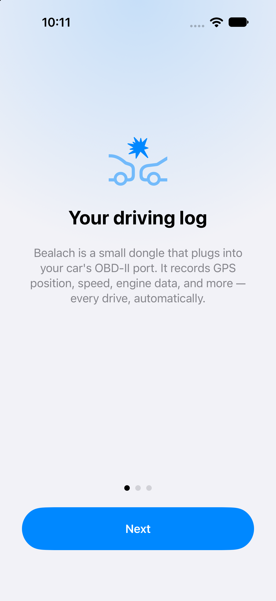
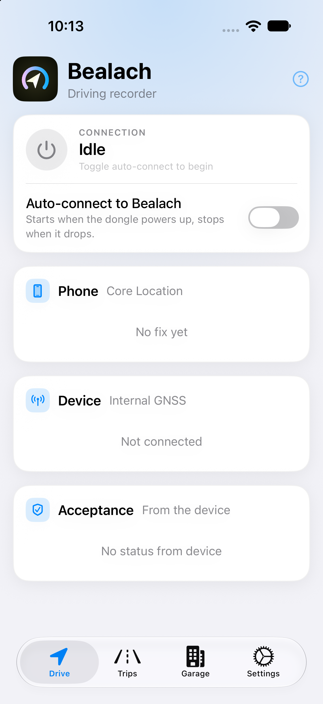
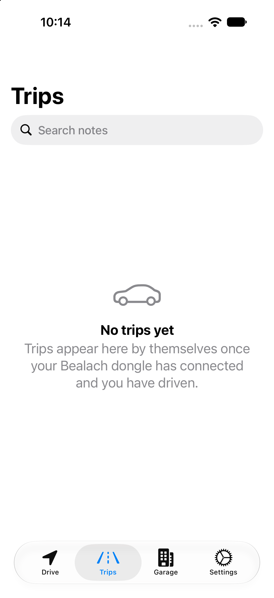
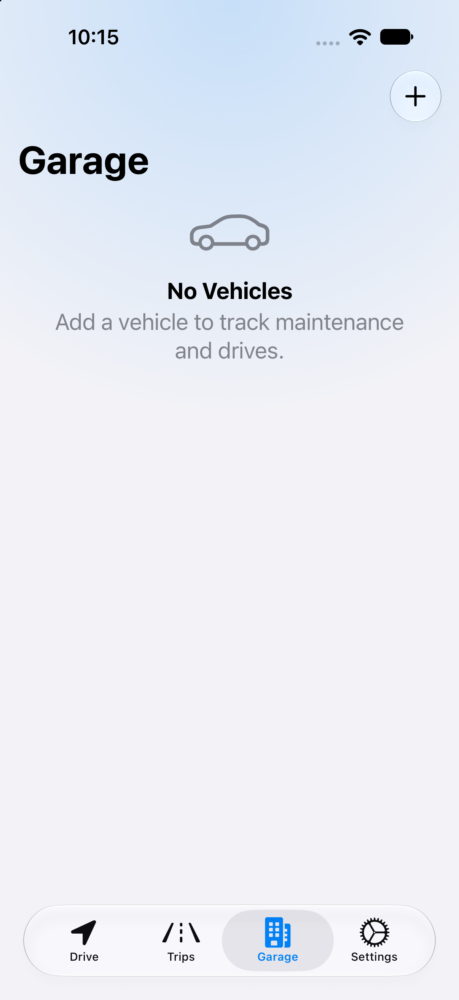
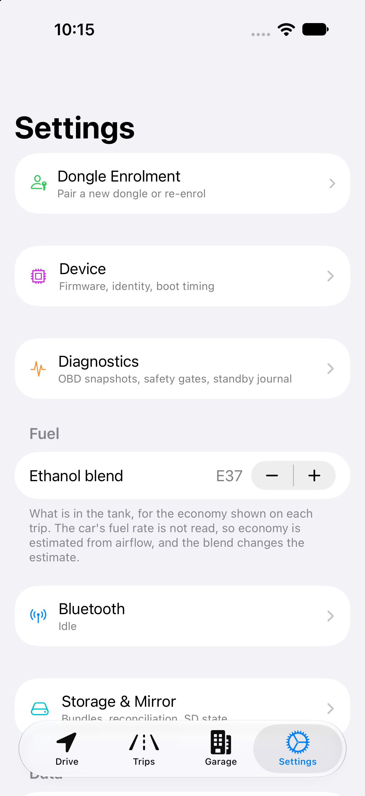
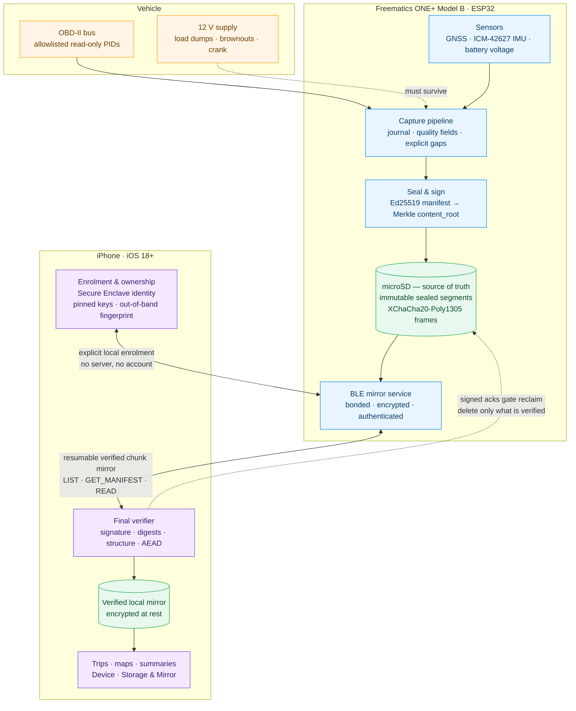

# Bealach

[](LICENSE)
[](https://appstoreconnect.apple.com)
[](ROADMAP.md)
[](docs/acceptance-tests.md)
[](ci/README.md)
[](ci/README.md)

[-555555)](docs/hardware-and-research.md)
[](docs/implementation-plan.md)
[](docs/contracts/mirroring.md)
[](#what-it-deliberately-is-not)
[](#what-it-deliberately-is-not)
[](#what-it-deliberately-is-not)
[](docs/threat-model.md)

[](docs/contracts/recording.md)
[](docs/contracts/mirroring.md)
[](harvest/contracts/engine/v1/README.md)
[](docs/threat-model.md)
[](docs/contracts/recording.md)

[](harvest/README.md)
[](harvest/README.md)
[](harvest/contracts/format/v3/vectors/README.md)
[](ci/README.md)

A sibling project to [Cairn](https://github.com/ParkWardRR/cairn-driving-log-selfhosted):
same landscape, different journey.

Bealach is an **offline driving recorder**: firmware for the
[Freematics ONE+ Model B](https://freematics.com/products/freematics-one-plus-model-b/)
OBD-II dongle plus a lightweight native iOS app. The dongle records drives to its own
microSD card, independently of any phone. The iPhone is the viewer and the verified
mirror: it pulls recordings over Bluetooth Low Energy, verifies them cryptographically,
and shows trips, maps, statistics and device health.

**No backend. No server. No cloud account. No website. No desktop client. No LTE
upload.** BLE is the only device-to-phone transport. The SD card is the source of
truth; the phone holds a verified local mirror and is the final verifier and store.

---

## Screenshots

<p align="center">
  &nbsp;&nbsp;
  &nbsp;&nbsp;
  &nbsp;&nbsp;
  &nbsp;&nbsp;
  
</p>

*From left: onboarding, Drive (connection + telemetry), Trips, Garage (vehicle management), Settings (dongle enrolment, diagnostics, storage).*

## Status

**Phases 1-3 in progress.** Core firmware libraries (recording format, BLE
framing, crypto) and the full iOS app are migrated and building. The iOS app is
on TestFlight (`app.bealach.ios`, v0.1.0). Contracts are frozen, acceptance tests
cover the software-testable matrix, and dev tooling + CI run against golden
vectors. Hardware validation is pending.

Migration from Cairn is tracked in
[docs/migration-from-cairn.md](docs/migration-from-cairn.md); until a component is
carried over and tested here, it is not part of Bealach.

## What it does

- **Records on the dongle, phone or no phone:** GNSS with quality fields, raw
  timestamped accelerometer/gyroscope samples, vehicle supply voltage, a small
  allowlisted set of read-only standard OBD-II measurements, and recorder health
  (resets, losses, timing).
- **Mirrors to the iPhone securely over BLE:** explicit enrolment and ownership,
  encrypted authenticated access with no insecure fallback, resumable chunked
  transfer, integrity and authenticity checks, transactional import.
- **Shows the drive:** recent-trip summary, chronological trips with mini route
  maps, a zoomable trip detail map, vehicle association with manual correction, a
  Device screen, and a Storage & Mirror screen with real reconciliation state.
- **Keeps both copies honest:** SD originals are retained by default. “Matched”
  means matching authenticated content identities and validated contents — never
  equal byte counts or filenames.

## What it deliberately is not

- No arbitrary CAN tunnel, code clearing, coding, programming, actuator commands,
  security access, or manufacturer-specific probing.
- No continuous iPhone GPS or motion sensing; the dongle's sensors are the source.
- No server dependency of any kind at runtime, including at enrolment.
- Not a claim of zero operational risk — see
  [docs/vehicle-safety-and-power.md](docs/vehicle-safety-and-power.md).

## Architecture



- **Firmware** (ESP-IDF, C): capture to SD in immutable, versioned, authenticated
  recording segments; fast boot to first sample; BLE mirror service; owner-phone
  trust.
- **iOS app** (Swift/SwiftUI): AccessorySetupKit + Core Bluetooth for setup and
  connection, verified mirror import, trip browsing and maps (MapKit), settings,
  diagnostic export that excludes secrets and precise location by default.
- **Contracts** in [docs/contracts/](docs/contracts/): recording format, mirroring
  protocol, reconciliation semantics, deletion semantics. Test vectors are carried
  from Cairn where the contract is reused.

Security and fast boot are first-class acceptance criteria from milestone 1, not
later enhancements. See [docs/threat-model.md](docs/threat-model.md) and
[docs/boot-budgets.md](docs/boot-budgets.md).

## Relationship to Cairn

Bealach is related to [Cairn](https://github.com/ParkWardRR/cairn-driving-log-selfhosted)
but **independently buildable and usable**. It selectively migrates mature, tested
components from the Cairn repositories — the recording format, BLE framing, chunk
transfer, recovery and test-vector code — and replaces Cairn's server trust/receipt
model with authenticated device-to-owner-phone trust. No Cairn service is required
or contacted at runtime.

Provenance, pinned commits, and the reuse/adapt/exclude decisions:
[docs/migration-from-cairn.md](docs/migration-from-cairn.md).

## Development & CI

**CI is local only.** This project does not use GitHub Actions (or any hosted CI)
— checks run on your own machine, optionally in a Linux container via
[OrbStack](https://orbstack.dev/). See [ci/README.md](ci/README.md).

```sh
make ci        # run every check natively (macOS or Linux)
make ci-linux  # same checks inside a Linux container (OrbStack / Docker)
```

What runs today: documentation link integrity, a local-only-CI policy check, and
the staged Cairn test suites in `harvest/` (engine-profile generator in Rust,
contract tools in Go) against the pinned contract vectors.

## Repository layout

```text
README.md                          this file
ROADMAP.md                         step-by-step execution roadmap (phases, tracks, gates)
LICENSE                            Blue Oak Model License 1.0.0
Makefile                           make ci — the local CI entry point
app/                               Xcode app target (xcodegen), icons, entitlements
  project.yml                      xcodegen spec → Bealach.xcodeproj
  Sources/BealachApp.swift         app entry point wiring all dependencies
  Resources/                       Info.plist, assets, entitlements
ci/                                local-only check scripts, Linux container
  check.sh                         runs every check
  links.py                         documentation link integrity
  linux.sh                         run checks in a Linux container (OrbStack)
  Dockerfile                       reproducible CI environment
contracts/                         carried contract specs + test vectors (from Cairn)
  format/v3/vectors/               ~60 byte-level recording format fixtures
  ble/v1/vectors/                  BLE protocol vectors (golden, offload, device-info)
  engine/v1/vectors/               engine profile validation vectors
docs/
  migration-from-cairn.md          selective migration and provenance
  hardware-and-research.md         hardware capability inventory + external research
  threat-model.md                  trust model, threats, hardware security limits
  vehicle-safety-and-power.md      OBD policy, interference, parked battery drain
  boot-budgets.md                  boot/performance budgets and measurement procedure
  implementation-plan.md           phased plan with acceptance criteria
  acceptance-tests.md              required test matrix
  open-questions.md                resolved blocking and non-blocking questions
  contracts/
    recording.md                   immutable segments, manifests, identities, gaps (frozen)
    mirroring.md                   secure resumable BLE mirror to the owner phone (frozen)
    reconciliation.md              what “matches” means; mirror screen semantics (frozen)
    deletion.md                    deletion, retention, reset and re-download rules (frozen)
firmware/                          product firmware tree (scaffold; migration in Phase 1)
  THIRD-PARTY-NOTICES              provenance and license attribution
ios/                               product iOS app tree (scaffold; migration in Phase 1)
  THIRD-PARTY-NOTICES              provenance and license attribution
tools/                             dev tooling — never product scope
  blevectors/                      BLE protocol vector generation (Go)
  contractcheck/                   contract conformance checks (Go)
  enginelang/                      engine profile expression language (Go)
harvest/                           staged Cairn code for later migration (not product)
```

Development tooling (vector generators, contract checkers) lives apart from
product code and is not part of the product scope: there is no desktop product and
no web interface.

## License

[Blue Oak Model License 1.0.0](LICENSE). Components migrated from Cairn are also
Blue Oak Model License 1.0.0; attribution and provenance are recorded in
[docs/migration-from-cairn.md](docs/migration-from-cairn.md).
