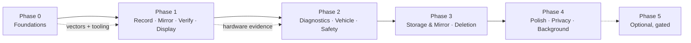
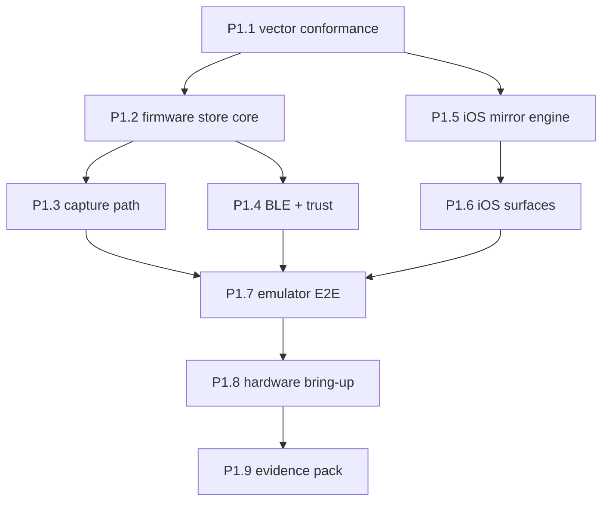

# Bealach roadmap

Execution roadmap: the ordered steps that get each phase of
[docs/implementation-plan.md](docs/implementation-plan.md) to its acceptance
evidence. That file holds the phase acceptance criteria (what "done" means);
this file holds the route (what to build, in what order, on which track, and
what gates each phase).

Nothing here is done until it is tested in this repository and recorded in
[docs/acceptance-tests.md](docs/acceptance-tests.md). "Hardware-validated"
means a physical Freematics ONE+ Model B plus an iPhone, nothing less.

## How to read this

Steps are numbered `P<n>.<m>` and carry one or more track letters. Steps within
a phase are dependency-ordered: a step lists the steps it needs finished first.
Acceptance-test IDs (T1, B2, K1, …) refer to
[docs/acceptance-tests.md](docs/acceptance-tests.md); budget references refer to
[docs/boot-budgets.md](docs/boot-budgets.md); safety gates refer to
[docs/vehicle-safety-and-power.md](docs/vehicle-safety-and-power.md) §6.

### Tracks

| Track | Scope | Sources of material |
|---|---|---|
| **A — Contracts** | The four contract documents, trip/leg semantics, wire formats, test vectors | `docs/contracts/`, `harvest/contracts/` |
| **B — Firmware** | ESP-IDF C for the Freematics ONE+ Model B | `harvest/firmware/` |
| **C — iOS** | Swift/SwiftUI app, iOS 18+ | `harvest/ios/` |
| **D — Tooling** | Go vector/contract checkers, host tests, emulator, CI gates. Never product scope | `harvest/contracts/tools/`, `harvest/firmware/test/host/`, `emulator/` |
| **E — Hardware & lab** | Physical dongle + iPhone, meters, boot-time and drain measurement | `harvest/firmware/research/` as reference |

Harvested Cairn code is staged under [harvest/](harvest/README.md) and follows
[docs/migration-from-cairn.md](docs/migration-from-cairn.md): rename on landing
(`cairn_*` → `bealach_*`, `Cairn*` → `Bealach*`), keep wire-format markers
(`CRN3`, KDF context strings) until Q7 says otherwise, carry a provenance note
on every file (source repo, pinned commit, path), and make the carried vectors
pass **before** any feature work depends on the code.

### Phase flow

---

## Phase 0 — Foundations (this repository)

Goal: the contracts are frozen, the blocking questions are answered, the trees
exist, and the carried vectors run. No product behaviour yet.

| Step | Track | What | Needs | Exit |
|---|---|---|---|---|
| P0.1 | A | Freeze the four contracts in `docs/contracts/` (recording, mirroring, reconciliation, deletion) as the plan of record. Resolve the trip/leg segmentation rule (**Q8**) here — it must be fixed before any Phase 1 UI work | — | Contract docs reviewed and marked frozen |
| P0.2 | A | Resolve blocking open questions **Q1** (single owner phone), **Q2** (key-escrow backup policy — a data-loss decision the owner must make), **Q3** (DTC reads: proposed Mode 01/09 only), **Q4** (first engine profile: proposed no OBD in Phase 1). Record answers in [docs/open-questions.md](docs/open-questions.md) | P0.1 | Q1–Q4 answered or explicitly deferred with an owner |
| P0.3 | A | Record the non-blocking answers: **Q5** (GNSS module variance — firmware reports observed capabilities), **Q6** (app distribution), **Q7** (keep `CRN3` wire markers for vector reuse; rename is cosmetic), **Q9** (buzzer in/out), **Q10** (iOS 18 floor confirmed) | — | Answers recorded |
| P0.4 | A/D | Scaffold the product trees (`firmware/`, `ios/`, `tools/`) with `THIRD-PARTY-NOTICES` and per-file provenance headers per the migration doc | P0.2 | Trees exist; notices name source repo, pinned commit and license for every carried file |
| P0.5 | A/D | Import the carried vectors: `contracts/format/v3/vectors/` (~60 dirs), `contracts/ble/v1/vectors/`, `contracts/engine/v1/vectors/`, each labelled with provenance. Device-info vectors are **draft — verify before trusting** | P0.4 | Vectors land with provenance labels |
| P0.6 | D | Land the dev tooling (`blevectors`, `contractcheck`, `engine-check`) as out-of-product Go tooling; note the engine profile validator | P0.5 | Checkers run against the imported vectors |
| P0.7 | D | CI gate via `make ci` ([ci/](ci/README.md)): vector suites + firmware host tests + iOS unit tests run on every change; `boottime_check` budget gate stubbed until P1.8 | P0.6 | `make ci` green on the scaffolds |
| P0.8 | A | Retire the "not yet consulted" items in [docs/hardware-and-research.md](docs/hardware-and-research.md) §3.1 that Phase 1 needs: ICM-42627 datasheet (sample ranges), ESP-IDF BLE security docs (pairing model). u-blox manual and SAE texts can wait for Phase 2 | — | Assumptions A2/A5 marked confirmed or corrected |

**Gate 0 — accept:** docs reviewed; Q1–Q4 resolved or explicitly deferred with
an owner; vectors importable and runnable; tooling scaffold kept out of product
scope.

---

## Phase 1 — First implementation milestone (the headline goal)

**Record a short trip to SD, securely mirror it to iOS, verify exact content
agreement, and display its route, summary, device status, and storage state.**

No OBD required in this phase (Phase 2 adds it) unless the engine profile is
ready — per **Q4** the default is GNSS + IMU + voltage + health + journal only.
Security and fast boot are acceptance criteria from the first step, not later
enhancements.

### Steps

| Step | Track | What | Needs | Exit |
|---|---|---|---|---|
| P1.1 | D/A | Reader-skeleton conformance: a minimal C writer and Swift reader against the format-v3 vectors, plus the carried `mutate` suite. This is the C-writer/Swift-reader interop ground truth before any feature code | P0.5–P0.7 | Vector suite passes on both skeletons; all mutations detected (C6) |
| P1.2 | B | Harvest the SD-is-source-of-truth core: `cairn_bundle`, `cairn_fs`, `cairn_store`, `cairn_format`, `cairn_log`, `cairn_boottime` → `bealach_*`, with host tests (`bundle_test`, fault/recovery tests, `boottime_test` 32 rows). Append-only segments, atomic-rename seal, torn-tail recovery at boot, `(boot_id, seq)` ordering, off-card monotonic counter | P0.4, P1.1 | Host tests pass under `bealach_*` names |
| P1.3 | B | Capture path: sensor tasks (GNSS with mandatory quality fields and sentinels, ICM-42627 summary + raw windows, vehicle voltage, device health, journal with standby/wake pairs and explicit gaps `GNSS_GAP` etc.), trip/leg model per the P0.1 rule, pre-roll buffer (≥30 s target) with drop-oldest-health-first and a loss record. Boot-time instrumentation with the normative stage marks. UTC is an estimate with uncertainty; ordering truth is `(boot_id, seq)` (Cairn #38, #40) | P1.2, P0.1 | Emulator recording produces a valid sealed bundle; host tests pass |
| P1.4 | B | BLE + trust: harvest `cairn_blesec` (bond fingerprint, stale-bond clearing, passkey pairing — Cairn #44) and adapt `cairn_offload`: `LIST`/`GET_MANIFEST`/`READ`/`PUT_ACK`/`ABORT`, MTU rules, `TRIP_ACTIVE`, content-addressed chunking, transfer-done CRC. Replace the server-receipt check with an owner-phone-signed acknowledgement verified against the key pinned at enrolment; default **no prune**. Adapt `cairn_prov` to owner-phone enrolment pins + ownership reset. Tests: `offload_test`, `offload_sim`, `blesec_test`, `prov_test`, interop vs the Go reader | P1.2 | Host tests pass; negative cases (`read_bad_arguments`, `unknown_bundle`, `trip_active`, `mtu_too_small`) pass |
| P1.5 | C | Mirror engine on iOS: harvest `CairnCore/BLE/*`, `BundleOffloader`, `SnapshotManifest`/`TarReader`/`SnapshotArchive`, `CairnRuntime/Store` (GRDB + encryption), `KeychainIdentity`/`SecureEnclaveIdentity` → `Bealach*`. Implement the mandatory six-step verification pipeline before durable import: manifest signature under the enrolled device key → `content_root` recompute → chunk SHA-256 → structural scan (headers, CRC chain, sequence) → frame AEAD under the escrowed `K_root` with `AUTH_FAILED` ≠ `CORRUPT_FRAME` → transactional staging + commit. Persistent verified-chunk progress; resume at the first unverified chunk; nothing partial is ever `verified`. Strip all server coupling | P1.1, P0.2 | `OffloadVectorTests`, `Contracts.swift` goldens, `SnapshotManifestTests` pass |
| P1.6 | C | iOS surfaces: enrolment/setup (AccessorySetupKit + bond) with out-of-band fingerprint comparison (E1), trip list with mini route maps, zoomable trip detail map (MapKit), trip summary (derived on the phone, kept separate from originals), Device screen (status, firmware build, boot timings over BLE from `cairn_devinfo`), Storage & Mirror screen with reconcile-now and snapshot-scoped states (`pending`/`transferring`/`verified`/`missing`, tombstone state deferred to Phase 3) | P1.5, P0.1 | UI flows work against the emulator |
| P1.7 | D/E | Emulator end-to-end: the Freematics emulator drives a full trip → mirror → verify → display. Exercise the Phase 1 acceptance cases at least in emulator: P1, P2, C1–C6, B1–B8, T1–T3, T8, T9, R3, S1, K1–K2 | P1.3–P1.6 | Cases pass with captured evidence |
| P1.8 | E | Hardware bring-up: flash the ONE+ Model B, record one real vehicle trip with **no phone present**, mirror it after the drive, iOS reports `verified` matching `bundle_id`/`content_root`/manifest hash, route and summary render. Fill the [boot-budgets.md](docs/boot-budgets.md) §4 table (six case classes × ≥5 runs, power-on and wake) and measure verified throughput against the ≥10 KB/s floor / ≥25 KB/s target | P1.7 | First real trip verified; budget table filled (proposed vs achieved) |
| P1.9 | A/D/E | Evidence pack: vector runs on both sides, boot budget table, each Phase 1 acceptance ID checked off with its named evidence in [docs/acceptance-tests.md](docs/acceptance-tests.md) | P1.8 | Gate 1 evidence complete |

**Gate 1 — accept:** one real vehicle trip recorded without a phone present;
mirrored after the drive; iOS reports `verified` matching `bundle_id`/
`content_root`/manifest hash; route and summary render; boot budget table
filled for the cases in boot-budgets §4; vectors pass on both sides; power-cut
mid-write and mid-transfer cases exercised at least on the emulator.

### Phase 1 dependency order

---

## Phase 2 — Diagnostics, vehicle identity, safety hardening

Goal: allowlisted read-only OBD that can never starve sensing, honest vehicle
identity, and a measured parked-drain policy.

| Step | Track | What | Needs | Exit |
|---|---|---|---|---|
| P2.1 | A/D | Engine profiles: validate `contracts/engine/v1` + `tools/enginegen` as data-driven, reviewable allowlists. Validate at least one real profile (BMW N20 is `derived`, B58 is a stub — **Q4**) against pidtest-style raw replies before trusting it. Record Mode 03 DTC position per **Q3** (proposed: Mode 01/09 only) | Gate 1, P0.2 | One profile validated against raw replies |
| P2.2 | B | OBD snapshots on their own task and budget: request/answer bitmaps (`pids_requested`/`pids_answered`), per-profile cadence within a hard firmware ceiling, timeouts/retries with exponential backoff, `pid_error_count` for non-answers — never interpolated, never guessed (Cairn #37, #42). Stamp the engine profile in every manifest (Cairn #39) | P2.1, P1.3 | Quiet-ECU gaps recorded explicitly; sensing never blocks (R1, R2) |
| P2.3 | C | Vehicle identity: identification with confidence + manual correction; persistent personal vehicles separated from temporary rentals; ambiguity stays ambiguous until a human resolves it; vehicle change creates a new assignment, never a silent merge (R4, R5) | P1.6 | Vehicle flows pass (R4, R5) |
| P2.4 | B/E | Parked-standby policy: drive states vs standby (light sleep, motion + voltage wake, radios down, slow health/voltage tick), matched standby journal pairs so parked current is attributable per state; re-measure after any duty-cycle change. Metered 12 h park against the ≤25 mA average target | P1.3 | Parked mA recorded; journal pairs consistent with the meter (K5) |
| P2.5 | E | Safety gates ([vehicle-safety-and-power.md](docs/vehicle-safety-and-power.md) §6) on hardware: quiet ECU ⇒ sensing continues; missing/failed SD ⇒ bounded RAM buffer + reported loss; power loss mid-write ⇒ torn tail handled, no uncontrolled bus traffic at reboot; absent ECU ⇒ GNSS/IMU/voltage/health still recorded; vehicle change ⇒ new assignment | P2.2–P2.4 | All five gates pass on hardware (R1, R2, S1, S2, P5) |

**Gate 2 — accept:** all §6 safety gates pass on hardware; parked mA recorded;
engine profile stamped in manifests.

---

## Phase 3 — Storage & Mirror completion and deletion flows

Goal: reconciliation you can trust, and deletion that is explicit, resumable and
never silent.

| Step | Track | What | Needs | Exit |
|---|---|---|---|---|
| P3.1 | A/C | Full reconciliation semantics: verdicts scoped to a specific `LIST` snapshot (sequence/time marker), growing capture is `pending` never `mismatched`, stale indicators when the dongle is unreachable (last reconciliation shown as *last*), local-only corruption detection (`corrupt` offline), plain-language discrepancy explanations for every non-verified state (S3–S6) | Gate 2 | Storage & Mirror screen shows snapshot identity, reachability and explanations |
| P3.2 | A/C | Deletion flows: per-action confirmation language stating what survives, what becomes unrecoverable, that an active recording is never erased, and that deletion never propagates silently; tombstones (recording id + content root + time + actor) that block auto re-download with an explicit "fetch again" that clears the tombstone (T4, T6) | P3.1 | Deletion confirmations and tombstones behave per [contracts/deletion.md](docs/contracts/deletion.md) |
| P3.3 | A/B/C | Explicit, configurable SD reclaim limited to **verified** mirrored data (signed owner-phone ack naming exact content stored AND phone copy verified); reclaim journal written before and after each removal; durable intents `to-delete` → `deleting` → `deleted`/`failed` with resumable bookkeeping (T5, T7, P3) | P3.2 | Reclaim touches only verified data; interrupted reclaim recovers |
| P3.4 | A/D | Hardening + matrix: ack replay and forged-ack rejection with no state change (T8), ack naming wrong content rejected and surfaced (T9), then run the full deletion matrix in [acceptance-tests.md](docs/acceptance-tests.md) | P3.3 | Deletion matrix passes; interrupted-deletion recovery demonstrated |

**Gate 3 — accept:** deletion matrix passes; interrupted-deletion recovery
demonstrated.

---

## Phase 4 — Polish, privacy, background behaviour

Coarser stages; each ends with recorded evidence.

1. **Settings & retention** — sampling, retention, summary range, privacy,
   transfer behaviour; settings written by the owner phone over the
   authenticated link, sealed to the device key, validated against the same
   allowlists; toggles honoured on-device (X3).
2. **Diagnostic export with redaction** — no secrets, no precise location by
   default; manual redaction review recorded (X1, X2).
3. **Derived-data polish** — summary date-range selection, cached map previews,
   incremental processing.
4. **Background BLE** — app suspended during mirror resumes via state
   restoration within 10 s wake windows (K3); app killed with the dongle
   advertising reconnects via restoration/pending connection (K4); bounded
   scan/reconnect backoff, no thrash (K7).
5. **Battery numbers** — measured iPhone consumption during driving and during
   transfer windows; no continuous iPhone GPS/motion (K6).
6. **Troubleshooting** — stage-specific, actionable recovery for stale bonds,
   low storage, missing SD, absent ECU.

**Gate 4 — accept:** background behaviour matrix pass; battery-consumption
numbers recorded; export redaction reviewed.

---

## Phase 5 — Optional, gated (each is its own decision)

- **Multi-phone enrolment** — only after the single-owner model (**Q1**) has
  real usage experience; contract already reserves room.
- **BLE OTA with signed images** — requires a tested recovery plan. No
  irreversible eFuse changes (secure boot, flash encryption) without explicit
  owner approval **and** a tested recovery plan (E3).
- **CarPlay / widgets** — only if they justify the energy and complexity cost.

---

## Cross-cutting rules

- Reuse mature, tested components per
  [docs/migration-from-cairn.md](docs/migration-from-cairn.md) rather than
  inventing new cryptography. No new cipher suites: XChaCha20-Poly1305,
  Ed25519, SHA-256, HKDF-SHA256, CRC-32-IEEE as carried.
- Migrated code lands with its provenance note and passing carried vectors
  **before** any feature work depends on it.
- Benchmarks are never improved by bypassing security checks: enrolment
  verification, AEAD and manifest checks stay on the path.
- Dev tooling never becomes product scope.
- No "hardware-validated" claim for any component until it has run on the
  physical ONE+ Model B under Bealach firmware and been recorded in
  [docs/acceptance-tests.md](docs/acceptance-tests.md) results.

## Risk register (inherited lessons → the step that retires them)

| Risk (Cairn issue) | Symptom | Retired by |
|---|---|---|
| OBD blocks sensing (firmware #37) | 766 s of a 1002 s drive lost | P2.2 task isolation + R2 |
| Lost UTC basis (firmware #38) | Every trip dated 1970 | P1.3 explicit time basis + R3 |
| Missing engine provenance (firmware #39) | Bundle unknown origin | P2.2 manifest stamp |
| ECU quiet periods (firmware #42) | 23 s gaps invented | P2.2 explicit non-answers |
| BLE pairing lockout (firmware #44) | Offload permanently blocked | P1.4 stale-bond recovery + B2 |
| Per-boot trips (app #40) | Wrong outing segmentation | P0.1 trip/leg rule + P4 |
| Unmeasured boot budgets (#25/#19) | Budgets are fiction | P1.8 instrumented boot record |
| Assumptions A1–A7 untested | GNSS variance, IMU rates, BLE 10–25 KB/s, ~10 mA standby, ASKit UX, PID sufficiency, Mode 01/09 safety | P0.8, P1.8, P2.1, P2.4 |
| Key escrow loss (threat model T8) | SD becomes undecryptable | P0.2 **Q2** decision, then E2 in Phase 3–4 |
